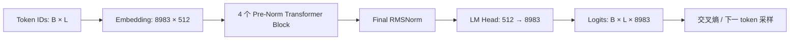

# CS336 Assignment 1 教学级语言模型技术报告

编写日期：2026-11-11（Asia/Shanghai）<br>
报告对象：当前模型实现、AdamW 与 Muon 训练结果、Trisol 云端训练记录、外部算子及注意力内核评估<br>
主要训练入口：[train_10k.py](train_10k.py)

本项目实现了一套 21,655,040 参数的自回归语言模型，包含字节级 BPE、数据流水线、Transformer、AdamW/Muon 优化器、训练恢复、文本生成和 Gradio 演示界面。模型采用 4 层 Decoder Transformer，组合 RoPE、RMSNorm、SwiGLU 与因果多头注意力，主要面向 TinyStories 文本续写和语言模型系统教学。GitHub 发布目录保留教学实现与 PyTorch 原生算子实现两个版本；它们共享模型参数布局，但算子路径和性能数据需按版本区分。

AdamW 历史 10,000 步运行处理了 327,680,000 个 token，抽样验证交叉熵为 1.376768。另一个 RMS 对齐 Muon+AdamW 10,000 步运行的验证交叉熵为 1.324593；它比 AdamW 基线低 0.052174。两者是独立运行，AdamW 旧记录未保存数据文件哈希，因此结果是有价值的对照证据，但不是多随机种子、逐字节确认数据完全相同的受控复现。

Trisol 云端另有一场从随机初始化开始的 10,000 步 Muon+AdamW 训练，验证 loss 为 1.116261，处理约 5.243B token；云端任务记录显示它使用 **1 张 A100**。本次还核实到一场 **2 张 A100** 的 64 步 DDP 权重续训，从 step 10,000 到 10,064。可见的 Trisol 作业中没有找到 10,000 步双 A100 的训练记录；两项云端结果及检索范围见 [Trisol 训练记录](reports/trisol_training_records_20261111.md)。

训练算子短基准显示，PyTorch SDPA、fused AdamW、foreach 梯度裁剪与内置交叉熵组合后吞吐量约提高 54%，峰值张量显存约降低 42%；该版本已放在 GitHub 的 `pytorch_native/`。另有独立 Triton 因果注意力内核评测，在 RTX 3070 Ti 上相对之前的本地 Triton 实现降低约 1.4%–7.5% 的前反向延迟；它目前仍是独立内核，不是模型的默认注意力实现。上述算子结果都不是新的完整训练收敛实验。

推理专项评估显示，在 batch=1、256-token 初始上下文下，当前受控解码约为 39.3 tokens/s，SDPA 加末位置投影原型约为 259.7 tokens/s；该设置下 KV cache 尚无稳定额外加速。固定样例能生成英文故事，但解释性问题和中文指令样例未获得有效回答。推理速度、生成质量和交互延迟分别在第 8 节评估。

## 1. 报告范围与证据口径

本文区分以下三种状态，避免把实验方案当作已经接入的功能。

| 状态 | 含义 | 主要证据 |
| --- | --- | --- |
| 教学实现 | 自定义分块注意力、AdamW、梯度裁剪与交叉熵；Muon 路径可选 | 项目根目录源码；GitHub `original/` |
| PyTorch 原生实现 | SDPA、PyTorch AdamW、foreach 梯度裁剪和内置交叉熵作为默认训练算子 | GitHub `pytorch_native/`；算子短基准见 [评估说明](assessments/external_libraries/assessment.md) |
| 完整训练结果 | AdamW 历史 10k 运行，以及 RMS 对齐 Muon+AdamW 10k 运行 | [AdamW 记录](runs/b128_s256_10k_20261015_171649_473135/result.json)、[Muon 对照报告](reports/muon_adamw_rms_alignment_10000.md) |
| Trisol 云端训练 | 从随机初始化完成的 10k Muon+AdamW（1×A100），以及 64 步 DDP 权重续训（2×A100） | [云端任务与指标摘要](reports/trisol_training_records_20261111.md)、[10k 指标 CSV](reports/trisol_muon_a100_10k_20261109_metrics.csv) |
| 内核基准 | 独立测试 Triton 注意力及 Muon 更新实现；不等于默认模型训练路径 | [Triton 注意力报告](reports/attention_kv_optimization_20261111.md)、[Muon 内核报告](reports/muon_optimizer_kernel_memory_20261110.md) |

历史运行记录中的 `MH_selfattention.py`、`block_attention.py` 和 `bpe.py` 哈希与当前文件不同。因此，历史 loss 表征该次训练的结果；当前实现的速度采用重新测量的数据。两者不能视为同一代码版本完成的一次实验。

本文以 `train_10k.py` 的实际配置为准。通用 `TrainConfig` 和模块构造器的默认值有所不同，例如通用训练默认 batch 为 16、序列长度为 512，`TransformerLM` 构造器默认词表为 784，均不代表主实验配置。不同日期的训练和内核基准使用的源码版本也不完全相同，不能拼成同一次运行。

## 2. 模型架构

### 2.1 整体数据流



每个 Block 的计算顺序为：

```text
U = X + Attention(RMSNorm(X))
Y = U + SwiGLU(RMSNorm(U))
```

残差连接分别包围注意力和前馈网络，归一化放在每个分支入口。最终输出再经过一次 RMSNorm 和独立词表投影，得到未归一化的下一 token 分数。

实现采用标准多头注意力，Q、K、V 的头数均为 16。所有线性投影均无 bias；输入嵌入与输出投影分别持有参数。位置通过注意力中的 RoPE 注入，模型没有独立的可学习位置嵌入表。当前模型未加入 Dropout。

实现依据：[transformer_LM.py](transformer_LM.py)、[transformer_block.py](transformer_block.py)。

### 2.2 主实验结构参数

| 参数 | 数值 | 说明 |
| --- | ---: | --- |
| 词表大小 `V` | 8,983 | 实际分词器词表 |
| 隐藏维度 `d` | 512 | 各层残差通道数 |
| Transformer 层数 `N` | 4 | 各层参数独立 |
| 注意力头数 `H` | 16 | Q/K/V 头数相同 |
| 单头维度 `D = d/H` | 32 | 相邻维度成对应用 RoPE |
| FFN 中间维度 `f` | 1,344 | 约为隐藏维度的 2.625 倍 |
| 训练序列长度 `L` | 256 | 每个训练样本预测 256 个位置 |
| 最大缓存位置 / 上下文窗口 | 512 | 当前 RoPE 缓存及生成窗口上限 |
| RoPE 基数 `theta` | 10,000 | 默认传入各层 |
| RMSNorm `eps` | 1e-5 | 默认传入各个归一化层 |
| 注意力 Q / KV 分块大小 | 64 / 64 | 当前手写分块注意力 |

“最大上下文 512”表示实现允许处理该长度，并不意味着主实验使用 512 长度训练，也不能据此认定超过 256 长度的生成质量已经验证。

### 2.3 注意力与位置编码

输入 `X` 的形状为 `[B, L, 512]`。Q、K、V 由三个独立线性层投影，再变换为 `[B, 16, L, 32]`。RoPE 仅应用于 Q 和 K，随后执行因果注意力：

```text
Q' = RoPE(X Wqᵀ)
K' = RoPE(X Wkᵀ)
V  = X Wvᵀ
A  = softmax(Q' K'ᵀ / sqrt(32) + causal_mask) V
Attention(X) = ConcatHeads(A) Woᵀ
```

因果掩码允许位置 `i` 关注 `j ≤ i`。接口也支持布尔掩码和浮点加性掩码。当前通用注意力采用左上对齐的因果定义，Q/K 长度不同时仍按 `j ≤ i` 处理；这一点对未来增量解码的掩码设计很重要。

RoPE 将 `(0,1)、(2,3)…` 相邻特征成对旋转，频率为 `theta^(-2i/D)`。每层预先缓存正弦、余弦值，支持位置偏移或显式位置索引；缓存不计入可训练参数，也不持久化到模型 state_dict。

实现依据：[MH_selfattention.py](MH_selfattention.py)、[RoPE_module.py](RoPE_module.py)、[block_attention.py](block_attention.py)。

### 2.4 RMSNorm、SwiGLU 与初始化

RMSNorm 在最后一维执行：

```text
RMSNorm(x) = x / sqrt(mean(x²) + eps) * gain
```

归一化计算及增益乘法使用 FP32，最后恢复输入 dtype。每个归一化层只有一个长度为 512 的可学习增益向量。

SwiGLU 使用三个矩阵：

```text
SwiGLU(x) = [SiLU(x W_gateᵀ) ⊙ (x W_upᵀ)] W_downᵀ
SiLU(z) = z * sigmoid(z)
```

输入嵌入从标准正态分布在 `[-3, 3]` 区间内截断采样；线性和 FFN 权重采用标准差为 `sqrt(2/(fan_in+fan_out))` 的 Xavier 正态分布，并在正负 3 倍标准差处截断。RMSNorm 增益初始化为 1。截断采样通过逆分布变换实现，采样范围与均匀裁剪正态样本的分布不同。

实现依据：[rms_normalization.py](rms_normalization.py)、[ffn_module.py](ffn_module.py)、[parameter_init.py](parameter_init.py)。

## 3. 参数量与基础内存开销

### 3.1 参数精确统计

以 `V=8983、d=512、f=1344、N=4` 计算：

| 模块 | 参数公式 | 参数量 |
| --- | --- | ---: |
| 输入 Embedding | `V × d` | 4,599,296 |
| 单层 Q/K/V/O 投影 | `4 × d²` | 1,048,576 |
| 单层 SwiGLU | `3 × d × f` | 2,064,384 |
| 单层两个 RMSNorm | `2 × d` | 1,024 |
| 单个 Transformer Block | `4d² + 3df + 2d` | 3,113,984 |
| 4 个 Block 合计 | `N × (4d² + 3df + 2d)` | 12,455,936 |
| 最终 RMSNorm | `d` | 512 |
| 输出 LM Head | `V × d` | 4,599,296 |
| **全模型** | **`2Vd + N(4d² + 3df + 2d) + d`** | **21,655,040** |

“单层”各项已包含在 Block 合计中，不应重复加入总量。报告编写时已通过实例化 meta-device 模型重新核对总数和模块分组，共有 39 个参数张量。

输入嵌入和 LM Head 合计约占总参数量的 42.5%。若新模型改用权重共享，参数量可减少 4,599,296，降为 17,055,744，约减少 21.2%。这是结构修改，需要重新训练或显式迁移；直接绑定已有权重会改变当前模型函数，而且输入嵌入与输出头的初始化分布不同。

### 3.2 权重内存与训练峰值的区别

| 项目 | 按当前 FP32 参数估算 |
| --- | ---: |
| 模型权重 | 82.61 MiB |
| 参数梯度 | 82.61 MiB |
| AdamW 一阶、二阶矩 | 165.21 MiB |
| 上述三项合计 | 330.43 MiB |

BF16 AMP 按运算选择计算精度，当前训练并未把整个模型参数转换成 BF16。完整训练峰值还包括激活、logits、损失函数中间结果、注意力工作区和编译器生成的缓冲区，因此远高于 330 MiB。当前批次完整 logits 的形状为 `[128,256,8983]`，共有 294,354,944 个元素：BF16 本体约 561.44 MiB，单份 FP32 同尺寸张量约 1122.88 MiB。

## 4. 分词与数据流水线

### 4.1 字节级 BPE

Python 实现提供 GPT-2 风格正则预分词和字节级 BPE：基础字节 ID 为 0～255，当前唯一特殊 token 为 `<|endoftext|>`，ID 为 256。实际模型包含 8,726 条合并规则，总词表为 8,983。

编码不跨普通预分词片段或特殊 token 边界合并；解码先拼接字节，再按 UTF-8 解码，以保留被拆分到多个 token 的字符。流式接口保留尚未确定的末尾片段，处理跨输入块的特殊 token、缩写和空白边界。

BPE 训练实现采用预分词计数、pair 到受影响词条的索引、局部计数更新，以及带版本的优先队列，避免每次合并都扫描全部词条。代码提供多进程预分词计数及可选 CUDA pair 计数路径；已有主数据准备记录不足以证明这些可选路径均被实际使用或具有加速收益。

实现依据：[bpe.py](bpe.py)、[bpe_train.py](bpe_train.py)。

### 4.2 实际数据与预处理记录

| 项目 | 训练集 | 验证集 |
| --- | ---: | ---: |
| 文本文件 | `TinyStoriesV2-GPT4-train.txt` | `TinyStoriesV2-GPT4-valid.txt` |
| 原始字节数 | 2,227,753,162 | 22,502,601 |
| 记录的文档数 | 2,717,700 | 27,631 |
| token 数 | 544,548,083 | 5,499,380 |
| 二进制文件 | `train.bin` | `val.bin` |
| 二进制字节数 | 4,356,384,664 | 43,995,040 |
| 存储格式 | little-endian int64，无文件头 | little-endian int64，无文件头 |

实际全量数据由项目外的 Julia 工具生成，复用了已有的 8,983 词表样本分词器，没有在该次准备任务中重新训练分词器。模型文件位于 `tokenizer_julia/models/sample_model.toml`。

该次 Julia 处理使用 8 个线程，内部记录的处理、I/O 与完整 ID 校验耗时约 98.42 秒，外部进程墙钟时间约 102.08 秒，峰值 RSS 约 690 MiB。原有训练、验证文件的划分被保留。Python 另对首尾完整故事窗口进行了 token 序列对比，该对比不等于完整语料的 Python 重编码。

证据：[metadata.toml](metadata.toml)、[预处理记录](tokenization_julia_full.json)、[交叉验证记录](tokenization_julia_full_verification.json)。

### 4.3 训练批次与数据身份校验

DataLoader 通过 NumPy memmap 打开只读 token 数组，每次有放回地抽取 `B` 个起点，取长度为 `L+1` 的窗口，再拆为相差一个位置的输入和目标，输出 `torch.long` 张量。仅当前批次被复制并传入 GPU，整个语料保持在 CPU 文件映射中。窗口可以跨越故事分隔符，分隔 token 保留在连续 token 流中。

训练前会校验实际文件长度、全部 token ID 范围、SHA-256、分词器身份、词表大小及训练/验证来源。恢复训练时还比较保存的数据指纹，防止在分词器或数据已变化的情况下继续原实验。

实现依据：[dataloader.py](dataloader.py)、[prepare_data.py](prepare_data.py)、[data_metadata.py](data_metadata.py)。

## 5. 训练目标、超参数与恢复机制

### 5.1 目标与优化配置

目标是在每个位置预测下一个 token，对一个 batch 的所有位置取平均交叉熵。损失使用自然对数；困惑度定义为 `exp(loss)`。

| 配置 | 主实验取值 |
| --- | --- |
| batch / sequence | 128 / 256 |
| 每步预测 token 数 | 32,768 |
| 更新步数 | 10,000 |
| 累计处理 token 数 | 327,680,000 |
| 优化器 | 手写 AdamW |
| `beta1 / beta2 / eps` | 0.9 / 0.999 / 1e-8 |
| weight decay | 0.01 |
| 全局梯度范数阈值 | 1.0 |
| 学习率峰值 / 下限 | 1e-3 / 1e-4 |
| warmup | 500 步，线性增长 |
| warmup 后调度 | 余弦衰减 |
| 随机种子 | 42；验证采样器使用 43 |
| 日志 / 验证间隔 | 每 100 步 |
| 每次验证 | 20 个 batch |
| 检查点间隔 | 每 1,000 步，更新 `latest.pt` |

所有参数放入同一个优化器参数组，当前未单独排除 Embedding 或 RMSNorm 增益的权重衰减。

调度按从 0 开始的 iteration 计算：首步学习率为 0，第 500 个零基索引达到 1e-3，随后余弦衰减；第 10,000 个零基索引达到下限，实际最后一次更新的索引为 9,999。改变 `total_steps` 会改变整条余弦曲线。

累计处理 token 数约为训练语料 token 数的 0.602 倍。由于采用有放回随机窗口采样，该比值不是唯一 token 的实际覆盖率，也不是完成了固定顺序遍历的 0.602 个 epoch。

### 5.2 验证与指标口径

验证在 `no_grad` 下执行，并恢复原模型训练状态及验证采样器 RNG。由此，同一配置下各次验证使用可重复的抽样窗口。每次名义采样 655,360 个 token，约相当于验证 token 总量的 11.9%，窗口可能重复；报告中的验证 loss 是抽样估计，并非完整验证集逐 token 结果。

CSV 的 `train_loss` 是最近日志区间的平均值；`train_loss_last_batch` 以及结果 JSON 的 `train_loss` 是末个 batch 的损失。训练吞吐量排除验证、检查点保存和回调时间，首个窗口包含惰性编译时间。

### 5.3 检查点与可复现性

检查点包含模型、优化器、步数、训练配置、数据身份、Python/NumPy/PyTorch/CUDA RNG，以及 DataLoader 独立 RNG 状态。接口还支持保存可选 scheduler 或 scaler 的状态。

文件通过临时文件写入、flush/fsync 和原子替换保存。恢复前检查影响训练的配置；设备、输出目录、日志间隔等字段允许变化。编译通过原地 `Module.compile()` 启用，以保留参数名和 state_dict 键名。

已有检查点已经完成 10,000 步，按原配置恢复会直接返回结果。延长训练需要显式设计新的训练阶段或迁移配置，当前恢复校验会拒绝直接改变既定总步数。随机状态保存为恢复提供基础，但跨硬件、跨版本及更换数值后端的位级一致性仍需另行验证。

实现依据：[train_loop.py](train_loop.py)、[train_utils.py](train_utils.py)、[adamW.py](adamW.py)、[checkpoint.py](checkpoint.py)。

## 6. 当前已经采用的优化措施

### 6.1 计算精度与编译

| 已采用措施 | 当前实现与作用 | 边界 |
| --- | --- | --- |
| BF16 AMP | 对适合的矩阵运算使用低精度，提高吞吐并减少部分激活占用 | 权重仍为 FP32；注意力块内另有 FP32 转换 |
| TF32 | 主训练入口启用 CUDA matmul 与 cuDNN TF32 选项 | 具体收益取决于实际派发的算子与内核 |
| Inductor 编译 | 分别编译模型和训练交叉熵，减少 Python 调度并融合部分运算 | 存在首次编译开销；验证损失仍直接调用手写函数 |
| 编译与 CPU 线程限制 | Inductor 编译线程默认 1，OMP/MKL 默认 2；保存编译缓存 | 属于当前机器配置，未证明适用于所有机器 |
| RoPE 缓存 | 每层预计算 sin/cos，按位置索引 | 缓存范围当前为 512 |

### 6.2 分块注意力与反向重计算

当前注意力按 Q/KV 各 64 个位置分块，跳过因果区域之外的块，并使用在线 softmax 合并局部结果。每处理一个新块，维护累计最大值 `m`、归一化量 `l` 和加权输出累加器，借助最大值变化的指数缩放保持数值稳定。

在主实验形状下，单层完整 FP32 分数矩阵 `[128,16,256,256]` 的本体约为 512 MiB；一个 `[128,16,64,64]` 分数块约为 32 MiB。当前无稠密外部掩码的训练路径不保存完整注意力分数或概率矩阵。

反向传播保存 Q/K/V、输出和逐行 logsumexp，然后逐块重算概率并累计梯度。这是在注意力内部以额外计算换取存储节省。当前 TransformerLM 还可以按每 2 个 Block 为一组做 PyTorch activation checkpointing（设为 0 时关闭）；两种机制分别减少注意力中间状态和 Block 激活的保留量。手写注意力 backward 仅支持一阶导数。

该实现将低精度输入提升为 FP32 后计算块内运算，有利于教学验证和稳定性，但仍由多个 PyTorch 运算组成。分块策略减少了存储需求，融合内核则进一步减少中间张量读写和 kernel 启动，两者的性能效果需要分别评估。

### 6.3 损失、优化器与调度开销

| 已采用措施 | 具体作用 |
| --- | --- |
| 稳定交叉熵 | 先减最大 logit；低精度 logits 提升为 FP32；detach 最大值以避免无必要的 amax 反向 |
| AdamW 原地更新 | 复用矩状态，利用 `addcmul_`、`addcdiv_` 等减少临时计算 |
| 偏置校正合并 | 一阶矩校正并入标量步长；二阶矩的分母在同一临时张量上连续处理 |
| 精度转换缓冲区 | 参数 dtype 与矩状态不同时复用转换缓冲区；低精度参数的矩状态保持 FP32 |
| 稳定梯度范数 | 缩放后求范数，降低极大/极小梯度的溢出、下溢风险；非有限值在修改梯度前报错 |
| `zero_grad(set_to_none=True)` | 减少清零写入 |
| 降低指标同步频率 | loss 与区间统计主要在日志、保存边界读取到 CPU |
| 预先校验 token | Embedding 和损失的逐 batch ID 范围检查默认关闭，减少热路径校验 |

自定义 AdamW 路径仍逐参数更新；Muon 的 CUDA FP32 路径则已按矩阵形状批处理 Newton–Schulz 运算并融合部分更新。Muon 的有限梯度检查仍会同步一次 CPU/GPU，CPU/GPU 同步并未完全消除。逐项收益以第 13 节的独立基准为准。

### 6.4 数据与推理运行方式

数据侧采用 memmap、流式预分词、有界并行任务以及实际使用的 Julia 全量编码，控制主存占用。推理采用 `inference_mode`、可选 BF16 autocast，并在 Web UI 中缓存已加载的模型，避免每次请求重新载入权重。

## 7. 已完成训练的结果

下表来自 2026-10-15 的 AdamW 历史运行，保留其代码版本口径。

| 完成步数 | 区间平均训练 loss | 抽样验证 loss | 验证 PPL |
| --- | ---: | ---: | ---: |
| 100 | 6.904233 | 4.511281 | 91.0384 |
| 500 | 2.351439 | 2.266501 | 9.6456 |
| 1,000 | 1.896328 | 1.877516 | 6.5372 |
| 2,000 | 1.683546 | 1.674658 | 5.3370 |
| 5,000 | 1.484913 | 1.488260 | 4.4294 |
| 10,000 | 1.363947 | 1.376768 | 3.9621 |

最终末个训练 batch 的 loss 为 1.406871，与上表的区间平均值不同。训练和验证损失均持续下降；这些指标支持模型在当前分词器和数据分布上学到了可预测结构，但不足以推断通用问答、事实可靠性或指令遵循能力。

排除首个编译窗口后，历史训练吞吐量中位数约为 138,579 tokens/s。日志累计训练计时约 40.27 分钟；从运行配置开始时间到最终指标时间约 55.35 分钟，其中还包含准备、验证等开销，且不精确覆盖最终指标之后的保存时间。

现有记录未提供多随机种子重复实验、独立下游评测或更换后端后的完整收敛对照，不能仅凭短基准推断最终 loss 会改善。

### 7.1 RMS 对齐 Muon + AdamW 对照

2026-10-29 的训练先完成 2,000 步，再从该检查点续训至 10,000 步。Muon 更新 28 个注意力/FFN 矩阵；Embedding、输出头和归一化参数交给 AdamW。关键参数为 Muon LR 0.002、RMS 对齐缩放、momentum 0.95、Nesterov、5 次 Newton–Schulz 迭代、Muon weight decay 0；AdamW LR 0.001、weight decay 0.01。训练仍为 batch 128、序列 256、每步 32,768 token，使用 500 步 warmup 和 10,000 步余弦调度。

| 步数 | Muon 验证 loss | AdamW 验证 loss | Muon−AdamW |
| ---: | ---: | ---: | ---: |
| 2,000 | 1.595115 | 1.674658 | -0.079544 |
| 5,000 | 1.426143 | 1.488260 | -0.062117 |
| 7,500 | 1.355615 | 1.411683 | -0.056068 |
| 10,000 | **1.324593** | 1.376768 | **-0.052174** |

100 个共同评估点中，Muon 在 97 点的验证 loss 低于 AdamW；按 10,000 步结果，Muon PPL 约为 3.76，AdamW 约为 3.96。该结果来自单次 seed 和抽样验证；旧 AdamW 运行没有记录原始数据 SHA-256，因此不能确认两个训练 run 使用的文件逐字节相同。它支持该配置值得复现，不足以证明 Muon 对其他 seed 或训练设置普遍占优。详细曲线和逐点数据见[对照报告](reports/muon_adamw_rms_alignment_10000.md)与[指标 CSV](reports/muon_adamw_rms_alignment_10000_metrics.csv)。

### 7.2 Trisol 10,000 步 Muon + AdamW 训练

Trisol 作业 `cs336-tiny-muon-b512-s1024-10k-20261109`（`2119631749209141248`）于 2026-11-09 成功完成 10,000 步。作业从 seed 42 随机初始化的模型开始，使用项目 Muon+AdamW 实现和 TinyStories 数据；云端任务详情将资源记为 **1 × NVIDIA A100-SXM4-80GB、world size 1**，并将训练结果注册为 `kasamura-cs336-tiny-b512-s1024-10k:1`。

| 项目 | 云端记录 |
| --- | ---: |
| 有效 batch / microbatch / 梯度累积 | 512 / 128 / 4 |
| 序列长度 | 1,024 |
| 更新步数 / 处理 token | 10,000 / 5,242,880,000 |
| 优化器 | RMS 对齐 Muon + AdamW；Muon 矩阵参数 12,451,840，AdamW 参数 9,203,200 |
| 峰值学习率 / 调度 | Muon `0.002`、AdamW `0.001`；500 步 warmup 后余弦衰减 |
| 末步训练 loss | 1.099443 |
| step 10,000 的 Trisol 训练指标 | 1.090909 |
| 验证 loss | 1.116261 |
| 训练耗时 / 末段报告吞吐 | 11,169.8 秒 / 约 471,185 tokens/s |
| GPU 监控 | 平均利用率约 98.3%；监测峰值显存 39,902,511,104 bytes（约 37.2 GiB） |

末步训练 loss 与 Trisol `train/loss` 指标不是同一统计值：前者来自 `training_complete` 事件，后者来自 step 10,000 的进度指标。指标 API 每 100 步提供一条记录；已保存的云端指标快照见 [CSV](reports/trisol_muon_a100_10k_20261109_metrics.csv)。本次验证 loss 与本机的 256-token 验证设置、历史 AdamW/Muon 结果不构成严格对照：模型从随机初始化训练，序列长度、有效 batch、验证实现和代码打包版本均不同。费用 API 显示已结算，但没有返回最终金额；检查点没有下载到本地。

### 7.3 Trisol 双 A100 DDP 权重续训

作业 `cs336-tinystories-b256-s512-r2-20261107`（`2119016566531047424`）在两张 A100 上以 PyTorch DDP/NCCL 完成 64 步，从上传的 AdamW step 10,000 模型权重推进到 step 10,064。每卡 batch 为 256、序列长度 512，每次更新合计 262,144 个 token；新增 token 总量为 16,777,216。BF16 autocast 与 TF32 matmul 已启用，最后训练 loss 为 1.504097，单次抽样验证 loss 为 1.500642，训练计时约 53.97 秒。GPU 平均利用率约 73%，峰值显存约 41.26 GB。

这次运行只加载了已有 checkpoint 的模型权重，训练脚本新建 AdamW 优化器，没有恢复原 AdamW 动量状态；因此它是从 step 10,000 权重开始的短续训/分布式验证，不是原训练的精确状态恢复。Trisol `train metrics` API 对该自定义任务返回 `no_metrics_reported_terminal`，以上 loss 与时长取自云端历史日志；checkpoint 归档为可恢复的 opaque/custom 格式，未下载或注册为可直接部署的模型版本。

截至 2026-11-11，通过当前 Trisol 身份查询 `yh-team` 可见的 151 条作业，其中 14 条申请了两张 GPU。检索到的 10,000 步 TinyStories 任务是上文的一张 A100；未在当前可见任务中找到 10,000 步双 A100 的记录。该检索结果不能排除其他团队或身份下的记录，若找到对应任务 ID，应按其实际配置补充，不应将它与本节的 64 步双卡任务合并。

## 8. 推理模块评估与交互界面

### 8.1 当前推理路径与评估配置

模型加载后对 prompt 使用相同 BPE 编码，逐步执行 temperature 与 top-p 采样。top-p 保留使累计概率首次跨过阈值的 token；抽中任意特殊 token 后停止，最终文本排除特殊 token。可设置独立采样随机种子。

当输入或生成历史超过 512 个 token 时，仅保留最近窗口参与前向计算，并将其 RoPE 位置重新从 0 开始编号。当前每一步都重新运行整个窗口，并计算所有位置的词表投影，随后仅取最后位置的 logits。实际入口采用 `inference_mode` 与可选 BF16 AMP，没有 KV cache，也没有调用 `model.compile()`。

本次推理使用已有 10,000 步检查点和实际 BPE，设备为 RTX 3070 Ti Laptop GPU，PyTorch 为 2.14.0+cu126，batch=1。保留推理入口的默认 TF32 matmul 设置 `False`，不沿用训练脚本中主动开启 TF32 的配置。

以下两种测量分别回答不同问题：

- **受控模型时延**：从真实 `val.bin` 取固定 token 序列，固定初始长度，回放后续 16 个 token；不做采样和 EOS 早停，各实现输入完全相同。prefill 预热后测 5 次取中位数；decode 预热后测 3 组、每组 16 步，组平均耗时取中位数。逐步同步 CUDA，模拟实际采样中读取 token ID 的串行依赖。
- **真实生成请求**：直接调用原始 `generate()`，保留 BPE、top-p、特殊 token 早停及解码；通过采样位置记录实际生成 token 数，避免由字符数或重新分词猜测。每个 prompt 同 seed 重复两次。

原始数据、脚本及样例位于 [assessments/inference](assessments/inference/README.md)。正常模型、生成源码和已有检查点未被替换。

### 8.2 正确性与边界行为

现有生成单测 4 项全部通过，覆盖检查点的 train/val 分词器身份、top-p 阈值跨越、特殊 token 停止、UTF-8 字节拼接、上下文窗口和正常结束后的模式恢复。另外执行了 6 组专项检查，全部通过：

| 检查项 | 实测结论 |
| --- | --- |
| 初始裁剪、滑窗和 EOS | 小模型窗口为 4 时，prompt `abcdef` 的实际前向窗口依次为 `cdef → def! → ef!!`，EOS 不写入输出 |
| 异常后的模型状态 | 采样阶段注入异常后恢复原训练状态 |
| seed 可复现性 | 相同 seed 重复结果一致；显式 seed 的小模型 CPU 生成不消耗全局 PyTorch RNG |
| 零新 token | 返回原文本，未调用模型前向 |
| 非法请求 | 空 prompt、零 temperature、非法 top-p 和负生成长度共 5 个输入被拒绝 |
| top-p 分布 | 概率 `[0.6,0.3,0.1]`、阈值 0.8，4096 次采样计数为 `[2762,1334,0]`，与保留前两项并归一化为 `[2/3,1/3]` 一致 |

四条真实 GPU 请求也都在重复相同 seed 后得到相同 token 序列。这是当前硬件和数值后端上的有限验证，未证明跨后端、跨版本或所有 prompt 都有相同结果。

专项合约检查结果见[推理评估文件](assessments/inference/contracts.json)。

### 8.3 当前实现的长度扩展、延迟与显存

| 初始上下文 token 数 | 模型 prefill 延迟 | 后续受控 decode 平均每 token | decode tokens/s | decode 峰值张量显存 |
| --- | ---: | ---: | ---: | ---: |
| 16 | 6.09 ms | 6.16 ms | 162.3 | 101.38 MiB |
| 128 | 8.65 ms | 13.92 ms | 71.8 | 103.84 MiB |
| 256 | 18.87 ms | 25.46 ms | 39.3 | 106.66 MiB |
| 480 | 52.04 ms | 52.95 ms | 18.9 | 111.60 MiB |
| 512 | 53.83 ms | 52.30 ms | 19.1 | 111.95 MiB |

decode 列测量的是初始上下文之后的 16 次前向，长度随回放增长；512 行每一步均使用滑动后的 512-token 窗口。以上不含 BPE 和采样，不能当作完整服务吞吐量，也不与 batch=128 的训练 tokens/s 直接比较。小样本时延存在波动，480 与 512 行不应用于推断精细的单调关系。

当前未缓存的全窗口重算随长度显著变慢，而 batch=1 张量峰值仅约 102～112 MiB。该配置的主要优化目标是降低时延和重复计算。显存为 PyTorch 已分配张量峰值，未计入全部 CUDA 驱动占用和分配器保留空间。

单次测量的 CUDA 初始化约为 0.221 秒，随后 `load_model()` 约为 0.456 秒；加载后已分配张量约 83.77 MiB，其中模型参数为 82.61 MiB。该计时不包含 Python/依赖导入，也未清空操作系统文件缓存，不能视为整台机器完全冷启动的服务延迟。

### 8.4 推理优化原型的收益与限制

评估脚本用同一份已加载模型比较四条路径，均为 eager、BF16，SDPA 路径明确使用 FlashAttention 后端：

1. 当前完整前向。
2. 注意力保持当前实现，仅对最后位置执行最终 RMSNorm 和 LM Head。
3. SDPA 注意力加最后位置投影。
4. 在第 3 项基础上增加逐层预分配 KV cache；窗口溢出时重建，保留现有滑窗语义。

下表为受控 decode tokens/s，均排除采样：

| 初始 token 数 | 当前实现 | 仅最后位置投影 | SDPA + 最后位置投影 | 再加 KV cache |
| --- | ---: | ---: | ---: | ---: |
| 16 | 162.3 | 156.8 | 243.5 | 267.5 |
| 128 | 71.8 | 75.2 | 253.6 | 251.8 |
| 256 | 39.3 | 40.0 | 259.7 | 254.9 |
| 480 | 18.9 | 18.8 | 244.5 | 245.3 |
| 512 | 19.1 | 18.6 | 249.1 | 243.0 |

**已证实的主要收益来自 SDPA。** 组合方案在 256-token 上下文约快 6.6 倍，在 512-token 上下文约快 13.0 倍。仅减少 LM Head 的位置数量没有稳定的速度收益，但 512-token 情况下峰值张量显存由约 111.95 MiB 降到 101.90 MiB。

**KV cache 在本次小模型、batch=1、短上下文和 Python eager 路径中未获得稳定额外加速。** 每个请求的 BF16 KV 存储为 4 MiB：`4 层 × 2(K/V) × 16 头 × 512 位置 × 32 维 × 2 字节`。它确实减少历史位置计算，但整体时延改善尚不明显；需要进一步分解 Python 调度、kernel 启动、权重转换等开销。512 长度后为保持原语义，每一步均重建缓存，也无法持续享受增量计算的收益。

KV cache 原型与 SDPA 全窗口路径进行了逐 token logits 对比，包含窗口填满和溢出边界：FP32 最大绝对差约 `5.25e-6`、最大相对 L2 差约 `2.68e-7`；BF16 最大相对 L2 差约 0.53%。检查点上的这些位置 top-1 token 相同，但更换 GEMM 形状、精度或注意力后端可能改变随机采样序列，仍需生成质量回归。缓存原型仅供评估，尚未接入正常生成入口。

### 8.5 真实请求时延与生成质量

参数固定为 `temperature=0.8、top_p=0.9、seed=42、max_new_tokens=128`。下表采用第二次同 prompt 请求，减少首次形状初始化的影响；耗时包含编码、前向、采样、EOS 判断和解码，不含加载与 Web 排队。

| Prompt / 类型 | 输入 token | 实际新 token | EOS 早停 | 内部首 token 延迟 | 完整请求时间 | 新 token/s |
| --- | ---: | ---: | --- | ---: | ---: | ---: |
| `Once upon a time` / 英文故事 | 4 | 128 | 否，达到长度上限 | 7.53 ms | 1.151 s | 111.2 |
| `Lily found a small red box…` / 英文情节续写 | 13 | 89 | 是 | 7.38 ms | 0.805 s | 110.5 |
| `Explain why the sky is blue.` / 解释性问题 | 8 | 1 | 是 | 7.07 ms | 0.014 s | 72.5 |
| `请介绍一下你自己。` / 中文指令 | 27 | 92 | 是 | 7.75 ms | 0.848 s | 108.4 |

`Once upon a time` 在该进程首次测量此 prompt 时，首 token 延迟为 95.4 ms，重复后为 7.53 ms，说明首次请求/首次形状开销应独立记录。这里的内部首 token 是 `generate()` 中采样产生 token ID 的时间，不代表 UI 已将该 token 呈现给用户。

四个样例的定性观察为：

- 英文故事样例围绕 Lily、树和松鼠继续叙事，句子总体连贯；128 token 上限截断了尚未结束的句子。
- 红盒子样例续写了皇冠和愿望的故事，并以特殊 token 正常结束，能够延续给定实体和场景。
- 天空颜色问题只输出换行后结束，没有给出解释；其较短响应时间不能视为成功完成任务。
- 中文 prompt 被保留，但后续生成英文故事片段，没有完成中文自我介绍。该 9 字符 prompt 被编码为 27 个 token，说明字节覆盖能力不等于有效的中文任务能力。

完整文本见[生成样例](assessments/inference/samples.md)。这四例属于固定 seed 的定性观察，未形成统计性质量评分，也未覆盖事实正确性、鲁棒性、多轮对话或更广泛的 prompt 分布。

实际词表 8,983 下，孤立 top-p 采样连同 token ID 同步约为 0.364 ms/次。优化模型前向进入约 4 ms 区间后，采样开销值得继续分析；该孤立时间不等于完整生成中的精确耗时占比。

### 8.6 UI 与加载流程的工程评估

Gradio 界面复用生成和加载逻辑，提供 prompt、长度、temperature、top-p、seed 和 AMP 控件，默认本地监听 `127.0.0.1:7860`。初版源码检查发现的问题及当前状态如下：

| 初版问题 | 当前状态 |
| --- | --- |
| 回调一次返回完整文本，未使用流式输出 | 已逐 token 更新输出框和生成状态 |
| UI 以字符数差计算速度 | 已统一显示实际输出 token 数、内部首 token 时间、完整请求耗时和 token/s；特殊停止 token 单独计入内部 sampled_steps |
| 模型缓存键只比较检查点与分词器路径 | 已将解析后的设备和注意力后端加入缓存键，并规范化检查点、分词器路径 |
| 加载完整训练检查点 | 当前文件约 247.9 MiB，包含推理未使用的优化器等状态；可导出仅含权重、配置和 tokenizer 身份的推理包 |
| 单请求逐 token 循环 | 当前未实现动态批处理；队列容量不能代替并发吞吐和排队时延测试 |

上述 UI 结论来自代码检查，没有启动 Web 服务进行浏览器端计时。推理性能基准没有覆盖网络、队列、并发、CPU 推理和多硬件比较，也未计算请求时延 P95。

### 8.7 当前推理实现与 KV cache 决策

截至 2026-11-07，推理加载默认使用 SDPA，可通过 `--attention-backend block` 切回教学分块实现；直接构造 `TransformerLM` 仍默认使用 `block`，不会改变训练入口。`forward_last_logits()` 只对最后位置执行最终 RMSNorm 和词表投影。生成流共享同一套内部计时与 token 计数，Gradio 每生成一个普通 token 就更新文本。

当前容器没有 CUDA，无法重跑 RTX GPU profiler 或对 CUDA compile 做有效决策。在 CPU 小模型上，PyTorch profiler 记录到 block 路径 665 次算子调用、SDPA 路径 481 次；相同 token 轨迹的中位前向耗时分别约 0.71 ms 和 0.36 ms。简化 KV cache 原型的 CPU 小测每 token 约 0.31 ms，全窗口重算约 0.35 ms，但算子调用由 481 增至 483。单层固定形状的 KV decode + `torch.compile` 小测由约 0.153 ms 降至 0.107 ms，首次编译约 10 秒。以上仅说明 CPU 玩具模型中的潜在收益，不代表目标 GPU 的 kernel 启动或端到端收益。

结合第 8.4 节 RTX 3070 Ti 的实测，KV cache 相对 SDPA + 末位置投影在 16/128/256/480/512 token 上下文分别约快 1.10×、慢 0.99×、慢 0.98×、快 1.01×、慢 0.98×，没有稳定收益。因此它继续留在评估原型，不进入默认生成路径。后续要重新评估时，应在 CUDA 环境下用 profiler 看真实 kernel 数、CPU 调度和各形状耗时，再比较 eager/compile 与 cache 的组合，并覆盖滑窗溢出后的完整请求时延。

生成质量应另建英文故事续写、问答和多语言测试集。当前检查点适合用于教学续写演示，现有样例不支持将其定位为已验证的通用指令助手。

实现依据：[generate.py](generate.py)、[web_ui.py](web_ui.py)。性能及数值证据：[推理汇总](assessments/inference/summary.json)、[原始 JSONL](assessments/inference/results.jsonl)、[评估源码](assessments/inference/benchmark.py)。

## 9. 外部库替换的实测收益

### 9.1 基准方法

基准在 NVIDIA GeForce RTX 3070 Ti Laptop GPU、8 GiB 显存、PyTorch 2.14.0+cu126 上执行，保留当前模型、batch、序列长度、BF16、TF32 和编译配置。各方案使用独立进程和相同初始化种子，读取真实训练 token；学习率固定为 1e-3。

编译后预热 GPU；含数据加载的测量先预读相同的抽样序列，再恢复数据 RNG。每种方案测量 5 组、每组 10 个训练步骤，以组平均耗时的中位数汇总；组末执行 CUDA 同步。两种梯度裁剪均保留非有限值检查。

### 9.2 累计替换结果

| 方案 | 每步耗时，含读取 | tokens/s | 相对吞吐量 | 峰值张量显存 |
| --- | ---: | ---: | ---: | ---: |
| 当前实现 | 236.37 ms | 138,630 | 1.00× | 6.57 GiB |
| 注意力改为 SDPA / FlashAttention 后端 | 171.64 ms | 190,915 | 1.38× | 4.89 GiB |
| 再替换 fused AdamW、foreach 梯度裁剪 | 157.93 ms | 207,483 | 1.50× | 4.89 GiB |
| 再替换内置交叉熵并继续编译 | 153.71 ms | 213,186 | 1.54× | 3.79 GiB |

第一阶段完全使用 PyTorch 自带功能。官方文档提供 [SDPA 后端选择说明](https://docs.pytorch.org/docs/stable/generated/torch.nn.functional.scaled_dot_product_attention.html)及 [AdamW foreach/fused 实现说明](https://docs.pytorch.org/docs/stable/generated/torch.optim.AdamW.html)。

全部替换后，吞吐量增加约 53.8%，单步耗时减少约 35.0%，峰值张量显存减少约 42.3%。按短基准外推，10,000 步纯训练约由 39.4 分钟降至 25.6 分钟。内置交叉熵相对上一方案额外节约约 1.10 GiB 峰值张量显存。

这些数字排除编译、验证、日志和检查点保存。显存指标为 `torch.cuda.max_memory_allocated`，未计入全部驱动占用和分配器保留空间。完整运行还受持续功耗、温度和数据缓存影响；目前未完成这些替换后的 10,000 步收敛实验或旧优化器检查点兼容性验证。

PyTorch 原生算子版本位于 GitHub `pytorch_native/`，采用 SDPA、fused AdamW、foreach 梯度裁剪和 PyTorch 交叉熵。注意力单项基准的加速记录及数值小测见[独立评估报告](assessments/external_libraries/assessment.md)。本文以已保存原始 JSONL 的整步训练基准作为主要性能证据；没有用短基准替代新的完整收敛实验。

## 10. 改进方案与实施优先级

### 10.1 第一阶段：接入已有实测收益

| 优先级 | 方案 | 预期作用 | 成本与验收重点 |
| --- | --- | --- | --- |
| P0 | 配置化切换手写注意力与 SDPA | 当前主要速度和显存收益 | 较低；保留教学实现，比较输出、梯度和不同掩码 |
| P0 | 接入 fused AdamW 与 foreach 裁剪 | 减少逐参数运算开销 | 较低；核对 epsilon、weight decay、矩状态和恢复路径 |
| P0 | 接入内置交叉熵 | 降低损失计算显存 | 较低；确认 reduction、AMP 精度及目标维度 |
| P0 | 统一训练、验证后端配置 | 使验证也使用经验证的损失路径 | 较低至中等；分别测量验证耗时和数值一致性 |

这些替换已集中在 GitHub `pytorch_native/` 版本中；教学版本仍保留自定义实现。注意力后端支持 `block`/`sdpa` 切换。短基准只覆盖主训练形状和路径，不能代替通用注意力接口的全部语义验证，也没有验证更换优化器后的检查点状态迁移。要比较模型质量，应记录后端、PyTorch/CUDA 版本和源码哈希，并从相同初始权重启动完整训练。

### 10.2 第二阶段：减少生成端重复计算

SDPA 和末位置 logits 接口已接入推理路径。每层预分配的 KV cache 仍可评估：prompt 做一次 prefill，后续只计算新增 token 的 Q/K/V、FFN 和输出。本次 RTX 3070 Ti 基准没有显示稳定的额外时延收益，不宜将缓存作为默认路径或已量化的大幅加速项。

实现需要处理两个语义问题：

1. 增量解码的 query 必须关注所有允许的历史 key。当前注意力的左上因果掩码不能直接用于“一个 query 对一段历史 KV”；应显式处理历史长度或构造正确掩码。
2. 当前超过 512 后会裁剪窗口、重设位置并重新计算。如果要求保留这一行为，窗口溢出时需要重建缓存；若引入不同的滑窗或位置策略，应作为新的生成行为单独验证。

缓存原型已经完成固定输入的 FP32/BF16 logits、窗口边界和时延对照，数据见第 8 节。正式接入仍需生成质量回归、完整请求计时及更多长度和 batch 的测试，并通过 profiler 判断调度、kernel 启动、精度转换和计算各部分的开销。

### 10.3 第三阶段：融合词表投影与损失

完整 logits 和相关 FP32 中间结果是当前显存的重要来源。Liger 的 `FusedLinearCrossEntropy` 可直接接收最终隐藏状态、LM Head 权重和目标，按块计算词表投影与损失，并保留普通 logits 路径供生成使用。2026-11-10 在 RTX 3070 Ti 上完成了可选接入和整步试验：前向阶段峰值下降约 126–311 MiB，但反向阶段仍决定整步峰值；当前 128×256 配置的总峰值几乎不变，整步慢约 2–4%。因此目前仅保留为显式实验选项，不设为训练默认值。实现细节、误差和基准数据见[融合损失评估](assessments/fused_lm_head_ce/assessment.md)。

Liger 0.8.5 的损失调用内部包含 `Tensor.item()`，本机 Inductor 无法直接完整捕获该算子；实现将这个调用留在 eager 路径，Transformer 主干继续编译。可在更大 batch 或序列长度使前向 logits 成为显存瓶颈时重新评估。RMSNorm、RoPE、SwiGLU 的专用融合内核也可以在 profiler 确认开销后逐项评估。

### 10.4 数据与配置管理

词表大小小于 65,536，可将磁盘 token 存储改为 uint16，把训练文件从约 4.06 GiB 降为约 1.01 GiB，读取批次后再转换为 `torch.long`。实施需同步更新 dtype、长度、SHA-256 和恢复校验；这是存储格式迁移，不能仅改变读取参数。

预热后的 DataLoader 单项中位数约为 1.38 ms，相比约 154 ms 的训练步骤较小。因此，异步预取、pinned memory 和数据加载进程应在训练主瓶颈优化后再评估。已有 Julia 全量预处理已约百秒完成，也无需优先重写分词器流水线。

工程上可进一步统一训练/生成配置，补充完整依赖锁定和运行清单，并将当前位于项目外的分词器 artifact 纳入可迁移的实验目录。当前两个 requirements 文件并未完整描述 Web UI 等全部依赖。

### 10.5 模型质量与结构实验

质量改进应与算子性能优化分别设计实验。建议固定数据、token 预算和验证窗口，增加多 seed 对照、固定 prompt 续写集合以及独立验证抽样。

可依次研究更充分的 token 预算、512 长度训练、Embedding/LM Head 权重共享，以及按参数类型划分 weight decay。GQA 和更大模型属于后续结构实验，会改变参数或缓存布局，需重新训练和评估。当前没有证据证明这些改动一定降低验证 loss，应记录质量、速度和显存的共同变化。

## 11. 测试与复现

### 11.1 本次核验结果

2026-10-28 的报告版本记录了当时的 unittest 结果：22 个测试文件、104 个测试方法，**103 项通过、1 项因 CUDA 不可用跳过，无失败**；跳过项为 DataLoader 的 CUDA 设备测试。这是历史源码版本的测试记录，不代表本次 2026-11-11 更新后重新运行了整套测试。

覆盖内容包括模块形状和参考数值、注意力因果性和梯度检查、掩码与非连续张量、低精度稳定性、BPE 流式边界、数据身份、检查点恢复、训练中断恢复及采样行为。小模型测试和短基准均不能替代完整配置的长期训练验证。

历史测试日志作为本地运行产物没有随 GitHub 发布；同时复核了模型参数量、历史指标摘要与分词器词表规模。

后续专项测试分别记录在评估报告中：Muon 更新测试为 9 项通过、5 个子测试通过；Triton 注意力测试为 7 项通过、12 个子测试通过。推理补充评估单独执行了 4 项生成单测和 6 组专项合约检查，见第 8 节。这些是分日期、分范围的记录，不等于当前发布快照的统一整套测试结果。

当前解释器及依赖快照：Python 3.14.4、PyTorch 2.14.0+cu126、NumPy 2.5.4、regex 2026.9.29、Triton 3.8.0、Gradio 6.30.0。该快照描述当前环境，不代表各组件均在本次报告中完成运行验证。

### 11.2 常用命令

检查固定训练配置；该入口要求可用的 CUDA 与 BF16：

```bash
.venv/bin/python train_10k.py --dry-run
```

新建一次训练，目录名需尚未存在：

```bash
.venv/bin/python train_10k.py --output-dir runs/new_experiment
```

使用已有检查点生成：

```bash
.venv/bin/python generate.py \
  --checkpoint runs/b128_s256_10k_20261015_171649_473135/checkpoints/latest.pt \
  --tokenizer-path /path/to/tokenizer.toml \
  --prompt "Once upon a time" \
  --max-new-tokens 128 --temperature 0.8 --top-p 0.9 --seed 42
```

启动本地界面：

```bash
.venv/bin/python web_ui.py \
  --tokenizer-path /path/to/tokenizer.toml
```

运行本次使用的测试命令：

```bash
OMP_NUM_THREADS=2 MKL_NUM_THREADS=2 \
  .venv/bin/python -m unittest discover -s tests -v
```

复现 GPU 算子替换基准；会覆盖评估目录中的同名测量文件，不写模型检查点：

```bash
.venv/bin/python -u assessments/external_libraries/benchmark.py suite
```

复现推理专项检查与 GPU 基准；GPU 基准会覆盖推理评估目录中的同名结果：

```bash
.venv/bin/python assessments/inference/check_contracts.py
.venv/bin/python -u assessments/inference/benchmark.py
```

## 12. 源码与实验材料索引

| 主题 | 文件 |
| --- | --- |
| 模型装配与 Block | [transformer_LM.py](transformer_LM.py)、[transformer_block.py](transformer_block.py) |
| 注意力与 RoPE | [MH_selfattention.py](MH_selfattention.py)、[block_attention.py](block_attention.py)、[block_attention_triton.py](block_attention_triton.py)、[RoPE_module.py](RoPE_module.py) |
| 基础层与初始化 | [embedding_module.py](embedding_module.py)、[linear_module.py](linear_module.py)、[ffn_module.py](ffn_module.py)、[rms_normalization.py](rms_normalization.py)、[parameter_init.py](parameter_init.py) |
| 损失与优化 | [crossentropy.py](crossentropy.py)、[adamW.py](adamW.py)、[muon.py](muon.py)、[muon_kernels.py](muon_kernels.py)、[train_utils.py](train_utils.py)、[amp_utils.py](amp_utils.py) |
| 数据与分词 | [bpe_train.py](bpe_train.py)、[bpe.py](bpe.py)、[prepare_data.py](prepare_data.py)、[dataloader.py](dataloader.py)、[data_metadata.py](data_metadata.py) |
| 训练与恢复 | [train_10k.py](train_10k.py)、[train_loop.py](train_loop.py)、[checkpoint.py](checkpoint.py) |
| 生成与界面 | [generate.py](generate.py)、[web_ui.py](web_ui.py) |
| 完整训练证据 | [AdamW 运行配置](runs/b128_s256_10k_20261015_171649_473135/run_config.json)、[AdamW 指标 CSV](runs/b128_s256_10k_20261015_171649_473135/metrics.csv)、[Muon 10k 对照报告](reports/muon_adamw_rms_alignment_10000.md)、[Muon 逐点评估](reports/muon_adamw_rms_alignment_10000_metrics.csv) |
| 性能评估证据 | [评估报告](assessments/external_libraries/assessment.md)、[原始当前实现测量](assessments/external_libraries/current.jsonl)、[原始全部替换测量](assessments/external_libraries/sdpa_fused_ce.jsonl)、[汇总](assessments/external_libraries/summary.json)、[源码哈希](assessments/external_libraries/source_hashes.json) |
| 推理评估证据 | [方法说明](assessments/inference/README.md)、[原始数据](assessments/inference/results.jsonl)、[汇总](assessments/inference/summary.json)、[文本样例](assessments/inference/samples.md)、[正确性检查](assessments/inference/contracts.json)、[源码哈希](assessments/inference/source_hashes.json) |
| 新增 Muon 内核材料 | [更新精度评估](reports/muon_precision_update_20261110.md)、[时延与显存评估](reports/muon_optimizer_kernel_memory_20261110.md)、[同步开销评估](reports/muon_sync_benchmark_20261110.md)、[`muon_kernels.py`](muon_kernels.py) |
| 新增 Triton 注意力材料 | [实现与结果](reports/attention_kv_optimization_20261111.md)、[最终基准数据](reports/attention_fa2_steady_20261111.json)、[最终 profile](reports/attention_kv_final_20261111.json)、[`block_attention_triton.py`](block_attention_triton.py) |
| Trisol 云端训练记录 | [作业摘要、资源、指标口径](reports/trisol_training_records_20261111.md)、[10k 云端指标快照](reports/trisol_muon_a100_10k_20261109_metrics.csv) |

## 13. 2026-11-11 模型与内核更新

### 13.1 Muon CUDA 更新路径

当前教学版本的 Muon CUDA FP32 路径把 28 个矩阵按 Newton–Schulz 逻辑形状分组，批量执行 Gram 矩阵乘法，并以 Triton 融合 momentum/Nesterov 和参数更新。相对先前逐矩阵 eager 路径，Muon-only 更新中位延迟由 38.77 ms 降至 26.28 ms（低 32.3%），profile 中 kernel launch 从 1,911 次降至 72 次；峰值分配显存从 205.64 MiB 升至 388.01 MiB。Muon+AdamW 更新包的中位延迟从 41.05 ms 降至 28.78 ms，峰值显存从 313.24 MiB 升至 514.05 MiB。该内存统计只涵盖优化器更新，不含训练激活。首次调用还包含 CUDA/Triton 初始化，不能用冷启动时间代表稳态性能。

默认 Newton–Schulz 精度仍为 `tf32x3`。独立更新评测中，`tf32x3` 的完整参数更新相对 FP32 矩阵实现误差约 `2.94e-4`，Muon-only update 约 3.17 ms；`tf32` 误差约 `2.21e-3`，约 1.99 ms。低精度路径可通过配置选择，但这些短程优化器更新测量不包含语言模型前后向，也没有比较完整训练质量。

### 13.2 Triton 注意力内核

新实现以 KV 外循环累计 dK/dV，并通过 FP32 atomic 累加 dQ；前向和反向使用在线 softmax/概率重算，不存完整注意力矩阵。它保留输入 stride、支持 BF16/FP16 dot 和 autotune。当前测试代码在 RTX 3070 Ti、BF16、batch 1、8 heads、head dimension 64 下，与 FlashAttention 2.8.3 对照：长度 128、512、1024、2048 的本地前反向时间分别为 15.40、74.11、237.80、703.22 微秒；FA2 分别为 29.47、89.04、244.63、696.21 微秒。相对修改前本地版本分别减少 6.2%、6.5%、1.4%、7.5%。在更长序列上它与 FA2 接近，2048 时约慢 1%。

输出和梯度在所测形状通过 BF16 误差阈值检查，测试覆盖了非连续 stride、非方形序列、因果边界和 CUDA Graph 重放。测量仅代表本机、当前 tile/autotune、batch/head/dtype 组合；长度 1024/2048 上与 FA2 的差异很小，不应外推到其他 GPU。该模块目前由独立 benchmark 直接调用，`MH_selfattention.py` 的默认 `block`/`sdpa` 路径没有调用它，因此这些延迟不是本报告中 10k 模型训练吞吐量的一部分。

### 13.3 当前版本的结果边界

Muon+AdamW 的 10k 结果描述训练质量；Muon 更新和 Triton 注意力结果描述算子性能；PyTorch 原生版本的 1.54× 吞吐量结果描述短训练基准。三类结果使用的源码状态、调用范围和统计口径不同。任何一种都不能单独证明新内核降低了完整训练时间或改善了验证 loss。复现实验应使用同一初始 checkpoint、数据哈希、seed、token 预算和验证窗口，并单独报告峰值显存及稳态吞吐量。
