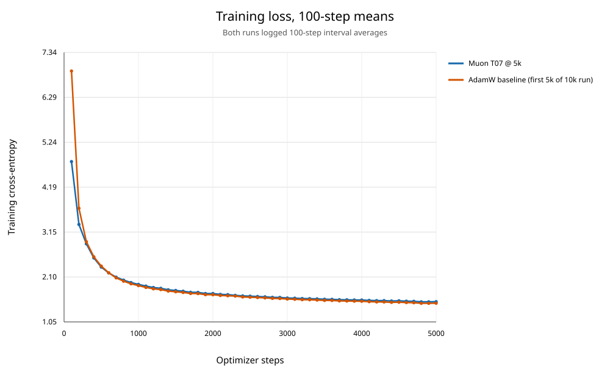
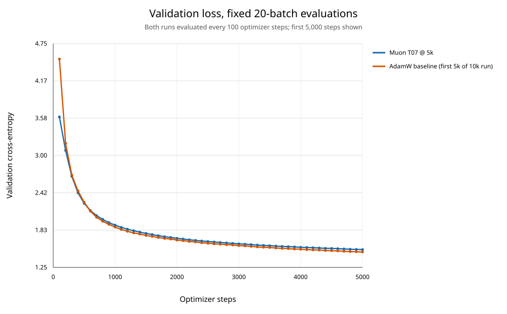

# Muon T07 与 AdamW：5,000 步 loss 曲线对照

## 曲线

## 同步步数结果

差值定义为 `Muon - AdamW`，负数表示 Muon loss 更低。训练 loss 均为前 100 个 optimizer updates 的平均值；验证 loss 为相同协议下固定 20 个 validation batches 的平均交叉熵。

| 步数 | Muon train | AdamW train | 训练差值 | Muon val | AdamW val | 验证差值 |
|---:|---:|---:|---:|---:|---:|---:|
| 100 | 4.790894 | 6.904233 | -2.113339 | 3.603802 | 4.511281 | -0.907479 |
| 500 | 2.328580 | 2.351439 | -0.022859 | 2.250527 | 2.266501 | -0.015974 |
| 600 | 2.192324 | 2.195588 | -0.003264 | 2.137778 | 2.128513 | +0.009265 |
| 1,000 | 1.924601 | 1.896328 | +0.028273 | 1.908840 | 1.877516 | +0.031324 |
| 2,000 | 1.711548 | 1.683546 | +0.028002 | 1.702237 | 1.674658 | +0.027579 |
| 3,000 | 1.606445 | 1.582426 | +0.024019 | 1.615676 | 1.588087 | +0.027589 |
| 4,000 | 1.560053 | 1.531101 | +0.028952 | 1.561380 | 1.530967 | +0.030412 |
| 5,000 | 1.520857 | 1.484913 | +0.035945 | 1.525671 | 1.488260 | +0.037410 |

## 结论

- Muon 在 5/50 个同步验证点上 loss 更低；AdamW 在 45/50 个点上更低。AdamW 首次领先的记录点是第 600 步。
- 到 5,000 步，Muon val loss 为 1.525671，AdamW 为 1.488260；Muon 高 0.037410（相对 AdamW 高 2.51%）。两条曲线都持续下降。
- 训练 loss 采用相同 100-step 窗口，因此也可直接对齐；训练 loss 的相对位置与验证 loss 大体一致。

## 运行配置与比较边界

- Muon：最优 trial T07 参数，RMS-to-RMS；Muon LR=0.002、WD=0、momentum=0.95、Nesterov、NS=5；非投影参数由 AdamW (LR=0.001, WD=0.01) 更新；10 步 warmup 后 constant。总计 5,000 步，保存间隔 1,000 步，最终 checkpoint 位于 `../runs/muon_rms_optimal_5000_20261029/checkpoints/latest.pt`。
- AdamW：已有 10,000 步 run，只取前 5,000 步；LR 峰值 0.001、500 步 warmup 后 cosine decay。
- 两边的模型规格、seed、batch=128、sequence=256、BF16 和 compile 配置相同；验证每 100 步评估 20 batches。Muon manifest 记录了数据 SHA；AdamW 旧配置未记录 SHA，因此无法追溯验证当时数据文件的字节内容完全一致。
- 这是两套既有 recipe 的对比，不是仅替换优化器的严格控制实验：Muon 与 AdamW 的 LR 和 schedule 不同。

## 文件

- Muon run metrics: `../runs/muon_rms_optimal_5000_20261029/metrics.csv`
- Muon final checkpoint: `../runs/muon_rms_optimal_5000_20261029/checkpoints/latest.pt`
- Muon run config: `../runs/muon_rms_optimal_5000_20261029/run_config.json`
- AdamW source metrics: `../runs/b128_s256_10k_20261015_171649_473135/metrics.csv`
- Matched step data: `muon_adamw_5000_matched_metrics.csv`
