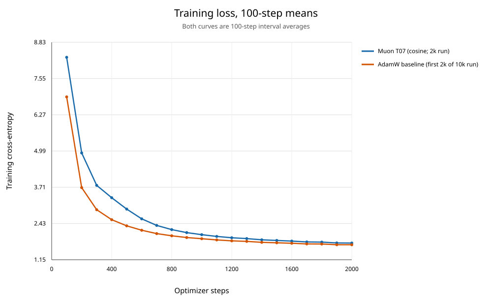
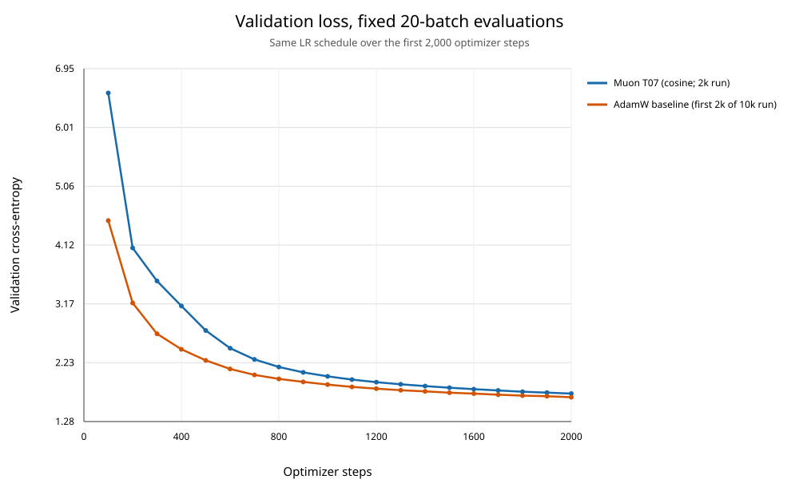

# Muon 与 AdamW：相同 cosine 调度下的 2,000 步对照

## 曲线

## 同步步数结果

差值定义为 Muon 减 AdamW。两边每 100 步记录训练窗口均值，并在相同协议的 20-batch 验证窗口上评估。

| 步数 | Muon LR | AdamW LR | Muon train | AdamW train | Muon val | AdamW val | val 差值 |
|---:|---:|---:|---:|---:|---:|---:|---:|
| 100 | 0.0003960 | 0.0001980 | 8.302462 | 6.904233 | 6.560528 | 4.511281 | +2.049246 |
| 500 | 0.0019960 | 0.0009980 | 2.942958 | 2.351439 | 2.745729 | 2.266501 | +0.479228 |
| 1,000 | 0.0019878 | 0.0009939 | 2.039329 | 1.896328 | 2.009573 | 1.877516 | +0.132057 |
| 1,500 | 0.0019513 | 0.0009757 | 1.835877 | 1.752817 | 1.827190 | 1.747014 | +0.080176 |
| 2,000 | 0.0018917 | 0.0009458 | 1.743714 | 1.683546 | 1.732718 | 1.674658 | +0.058060 |

## 结论

- Muon validation loss 更低于 AdamW 的同步点数为 0/20；AdamW 更低的点数为 20/20。
- 第 2,000 步 Muon val loss=1.732718，AdamW=1.674658，Muon 高 0.058060（相对 AdamW 高 3.47%）。两条曲线都持续下降。

## 调度与参数

- 复用 AdamW baseline 的调度时间轴：500 步线性 warmup，max LR 0.001、min LR 0.0001，cosine horizon 10,000 步；本次 Muon 运行至第 2,000 步，取该曲线前 2,000 步。
- Muon 使用 T07 参数，基准 LR=0.002，乘相同归一化 cosine factor，因此矩阵 LR 是 AdamW 基准 LR 的 2 倍；Muon WD=0、momentum=0.95、Nesterov、NS=5、RMS-to-RMS。其他参数仍由 AdamW (LR=0.001, WD=0.01) 更新。
- 两边 warmup、cosine horizon 和 max/min 比例逐步对齐；优化器及参数组 LR 不同，因此这是相同调度下的 recipe 对照。AdamW 旧 run_config 未保存数据 SHA，历史文件字节无法追溯校验；两次记录使用相同数据路径、seed 和验证协议。

## 删除与产物

- 已删除旧 Muon HPO 的 T01–T08 checkpoint、initial_model.pt，以及旧 5,000 步 run 的 latest.pt。保留旧 metrics、配置和报告；AdamW checkpoint 未删除。
- 新 Muon checkpoint：../runs/muon_rms_cosine_2000_20261029/checkpoints/latest.pt
- 新 Muon metrics/config：../runs/muon_rms_cosine_2000_20261029/metrics.csv 与 run_config.json
- 完整逐步数据：muon_adamw_cosine_2000_matched_metrics.csv
