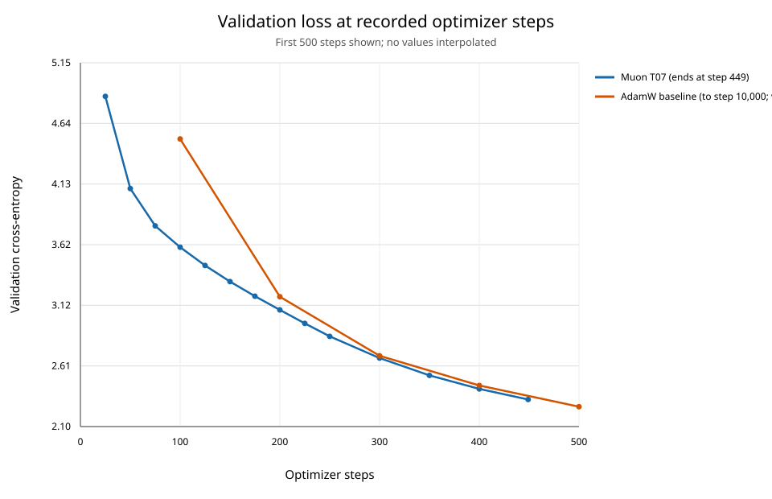

# Muon 与 AdamW 已有 loss 曲线对照

## 验证 loss（相同步数）

下表只列两次训练都实际记录验证 loss 的相同步数；差值定义为 `Muon - AdamW`，负数表示 Muon loss 更低。

| 步数 | AdamW val loss | Muon T07 val loss | 差值 | 相对差异 |
|---:|---:|---:|---:|---:|
| 100 | 4.511281 | 3.603796 | -0.907485 | -20.12% |
| 200 | 3.188560 | 3.078128 | -0.110432 | -3.46% |
| 300 | 2.693354 | 2.674275 | -0.019079 | -0.71% |
| 400 | 2.444404 | 2.415710 | -0.028694 | -1.17% |

## 观察

- 共同记录的 100、200、300、400 步上，Muon T07 的验证 loss 都低于 AdamW。差距从 100 步的 0.9075（低 20.12%）缩小到 400 步的 0.0287（低 1.17%）；两条曲线在 200 步后已很接近。
- Muon T07 最后记录在 449 步，val loss 为 2.326899。AdamW 在 500 步的 val loss 是 2.266501；这两个终点相差 51 步，因此不能视为同一步比较。AdamW 的 10,000 步最终 val loss 为 1.376768，训练步数远多于 Muon 本次的 449 步。
- 因此，在这组已记录数据里，Muon 前 400 步下降较快；AdamW 的长程最终 loss 更低，但 10k 对 449 步不能说明哪个优化器在等训练预算下更优。

## 可比性与限制

两次 run 的模型规格、seed、batch size（128）、sequence length（256）、数据路径、BF16/compile 设置及 20-batch 验证设置一致。两边的验证 loader 都使用 `seed + 1`，评估后恢复 RNG 状态，因此若历史数据文件内容未变，共同验证 checkpoint 对应相同的验证 batch 窗口。Muon manifest 记录了数据 SHA；AdamW 的旧 `run_config.json` 没有保存 SHA，因此无法事后确认 10 月 15 日运行时文件字节与 Muon run 完全一致。

学习率计划不同：Muon T07 的 Muon LR 为 0.002，10 步 warmup 后保持 constant；AdamW 的 LR 峰值为 0.001，warmup 500 步后按 cosine 衰减。Muon run 还将投影矩阵交给 Muon，其他参数仍由 AdamW 更新。因此这比较的是已有训练 recipe 的曲线，不是只改变优化器、其余超参数完全相同的控制实验。

训练 loss 的 CSV 是“自上次日志以来”的窗口均值；AdamW 每 100 步记录一次，Muon T07 在不同阶段每 25 或 50 步记录一次。窗口长度不相同，所以本报告用固定验证 batch 的验证 loss 作定量比较。

## 数据来源

- AdamW: `runs/b128_s256_10k_20261015_171649_473135/metrics.csv` 与 `run_config.json`
- Muon: `runs/muon_hpo_20261029_114312/metrics.csv` 与 `manifest.json`，trial `T07`
- 相同步数原始对照表：`muon_adamw_shared_validation_steps.csv`
