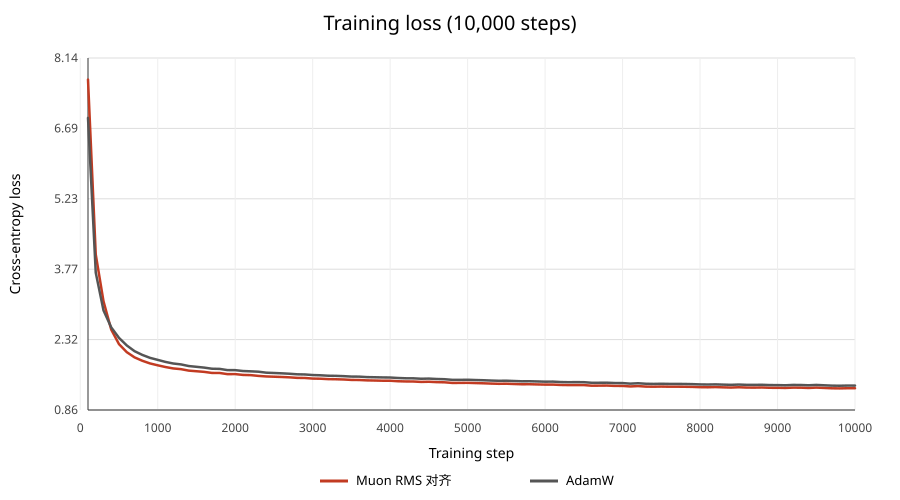
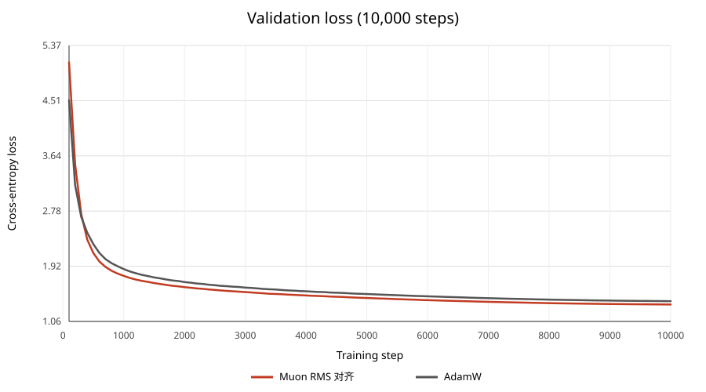

# Muon RMS 对齐续训至 10,000 步：与 AdamW 对照

## Loss 曲线

Muon 前 2,000 步取自 RMS 对齐 run；第 2,100–10,000 步从其第 2,000 步检查点续训。训练 loss 是前 100 步窗口均值；每个记录点使用 20 个 batch 评估验证 loss。

| 步数 | Muon train | AdamW train | Muon val | AdamW val | val 差值（Muon−AdamW） |
|---:|---:|---:|---:|---:|---:|
| 2,000 | 1.601904 | 1.683546 | 1.595115 | 1.674658 | -0.079544 |
| 5,000 | 1.421278 | 1.484913 | 1.426143 | 1.488260 | -0.062117 |
| 7,500 | 1.343696 | 1.401844 | 1.355615 | 1.411683 | -0.056068 |
| 10,000 | 1.308882 | 1.363947 | 1.324593 | 1.376768 | -0.052174 |

## 结果

- Muon 第 10,000 步 val loss 为 **1.324593**；AdamW 为 1.376768，Muon 低 0.052174（相对低 3.79%）。
- 共同的 100 个评估点中，Muon 在 97 点低于 AdamW；首次低于 AdamW 为第 400 步。
- 相比第 2,000 步 val loss 1.595115，第 10,000 步又下降 0.270521。

## 续训设置

从 `runs/muon_rms_alignment_cosine_2000_20261029/checkpoints/latest.pt` 恢复模型、Muon/AdamW optimizer state、数据采样 RNG 和训练 RNG，从已完成的第 2,000 步继续到总步数 10,000。配置保持最佳 RMS 对齐参数：`rms_alignment`、Muon LR 0.002、Muon weight decay 0、momentum 0.95、Nesterov、Newton–Schulz 5 步；其他参数由 AdamW 更新。

学习率采用 500 步 warmup 和 10,000 步 cosine horizon（max LR 0.001、min LR 0.0001）。原始检查点保留；续训写入独立目录。AdamW 使用已有 10,000 步基线，同步评估间隔与验证协议一致。历史 AdamW run 未保留数据文件 SHA，无法追溯校验原始数据文件字节。

## 产物

- 10k 配置：[muon_rms_alignment_cosine_10000.yaml](../configs/muon_rms_alignment_cosine_10000.yaml)
- 最终检查点：`runs/muon_rms_alignment_cosine_10000_resume_20261029/checkpoints/latest.pt`
- 最终结果：`runs/muon_rms_alignment_cosine_10000_resume_20261029/result.json`
- 每 100 步对比数据：`muon_adamw_rms_alignment_10000_metrics.csv`
