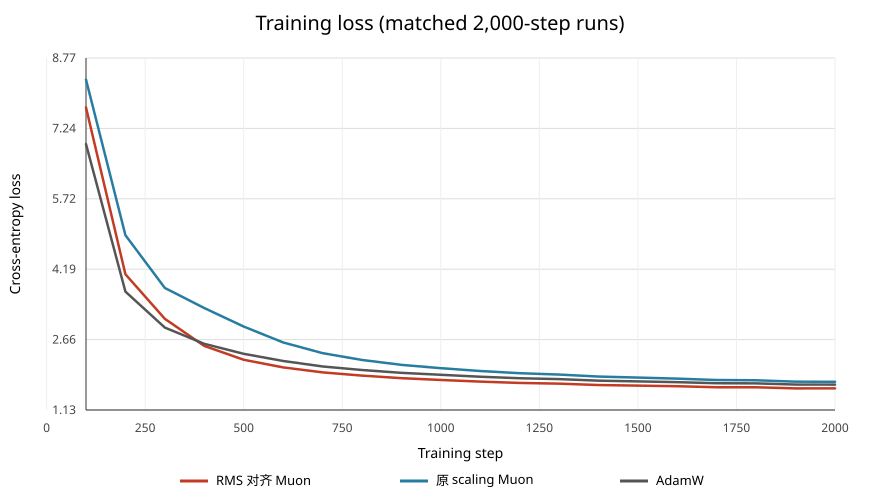
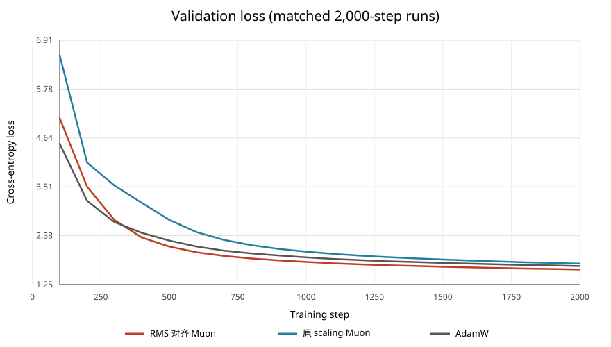

# Muon RMS 对齐 scaling：2,000 步实验

## Loss 曲线

每 100 步记录一次窗口训练 loss，并按相同验证协议（20 个 batch）评估。验证 loss 差值定义为 RMS 对齐 Muon 减去对照方法，负值表示新方案更低。

| 步数 | RMS 对齐 train | 原 scaling train | AdamW train | RMS 对齐 val | 原 scaling val | AdamW val | val 差值 vs 原 scaling | val 差值 vs AdamW |
|---:|---:|---:|---:|---:|---:|---:|---:|---:|
| 100 | 7.697181 | 8.302462 | 6.904233 | 5.102931 | 6.560528 | 4.511281 | -1.457597 | +0.591649 |
| 500 | 2.222034 | 2.942958 | 2.351439 | 2.128028 | 2.745729 | 2.266501 | -0.617701 | -0.138473 |
| 1,000 | 1.783805 | 2.039329 | 1.896328 | 1.771352 | 2.009573 | 1.877516 | -0.238221 | -0.106164 |
| 1,500 | 1.661039 | 1.835877 | 1.752817 | 1.659056 | 1.827190 | 1.747014 | -0.168133 | -0.087957 |
| 2,000 | 1.601904 | 1.743714 | 1.683546 | 1.595115 | 1.732718 | 1.674658 | -0.137604 | -0.079544 |

## 结果

- 第 2,000 步 RMS 对齐 Muon val loss 为 **1.595115**，原 scaling Muon 为 1.732718（新方案低 0.137604，相对降低 7.94%）；AdamW 为 1.674658（新方案低 0.079544，相对降低 4.75%）。
- 共同的 20 个评估点中，新方案 val loss 在 20/20 点低于原 scaling、在 17/20 点低于 AdamW；首次低于 AdamW 是第 400 步。
- 新方案记录到的最低 val loss 为 1.595115（第 2000 步）。

## scaling 公式和可选模式

Newton–Schulz 正交化得到 $O_t$ 后，新模式按下式更新矩阵参数：

$$\Delta W_t=-\eta_t\left(0.2\sqrt{\max(m,n)}O_t+\lambda W_t\right).$$

- 新 RMS 对齐模式：`muon_scaling_mode: rms_alignment`，scale 为 $0.2\sqrt{\max(m,n)}$。
- 原 operator-norm 对齐模式仍可选：`muon_scaling_mode: rms_to_rms`，scale 为 $\sqrt{m/n}$；`original` 模式也保留。CLI 支持 `--muon-scaling-mode`。
- 实验使用 T07 参数：Muon 基准 LR 0.002、momentum 0.95、Nesterov、Newton–Schulz 5 步、Muon weight decay 0；其他参数仍由 AdamW 更新。因此本次更新里的 $\lambda W_t$ 项为零。
- 学习率沿用既有对照：500 步 warmup、10,000 步 cosine 时间轴（max LR 0.001、min LR 0.0001），本次运行截取前 2,000 步。Muon 矩阵 LR 为 AdamW 同步标量 LR 的 2 倍。模型、seed=42、batch=128、sequence length=256、每 100 步验证保持一致。AdamW 历史 run 未保存数据文件 SHA，无法追溯验证文件字节完全一致。

## 产物

- 配置：`configs/muon_rms_alignment_cosine_2000.yaml`
- Checkpoint：`runs/muon_rms_alignment_cosine_2000_20261029/checkpoints/latest.pt`
- Run metrics/config：`runs/muon_rms_alignment_cosine_2000_20261029/metrics.csv`、`runs/muon_rms_alignment_cosine_2000_20261029/run_config.json`
- 逐步对照数据：`muon_scaling_rms_alignment_2000_metrics.csv`
